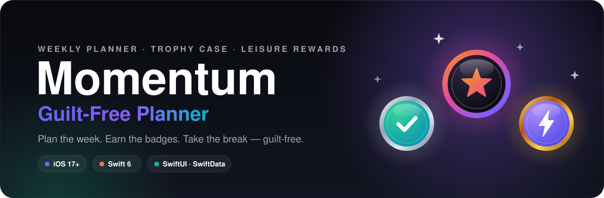
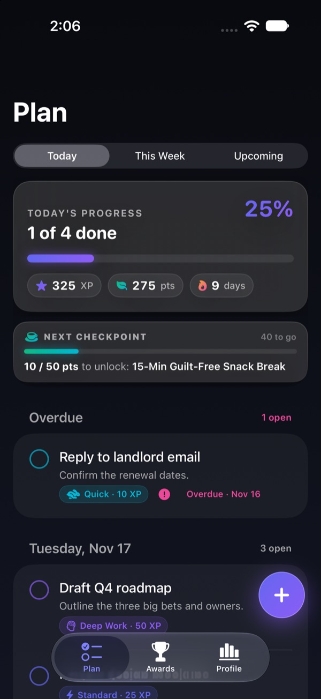
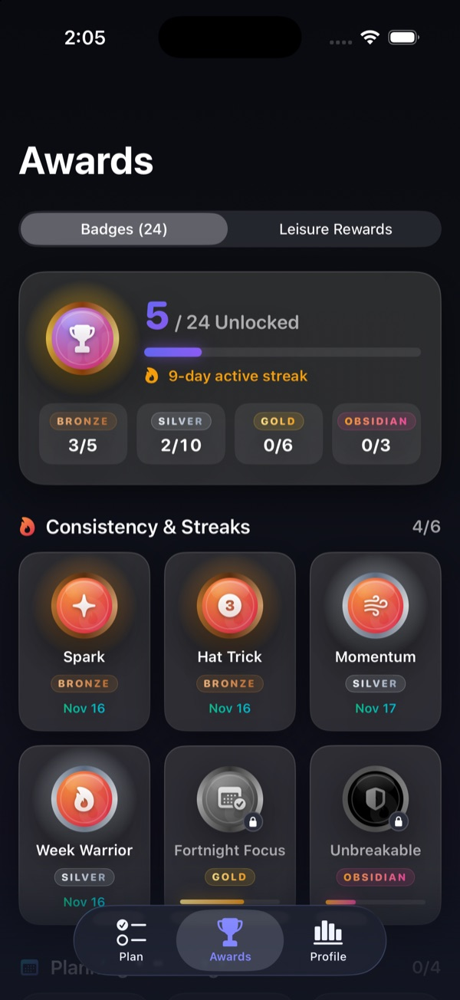
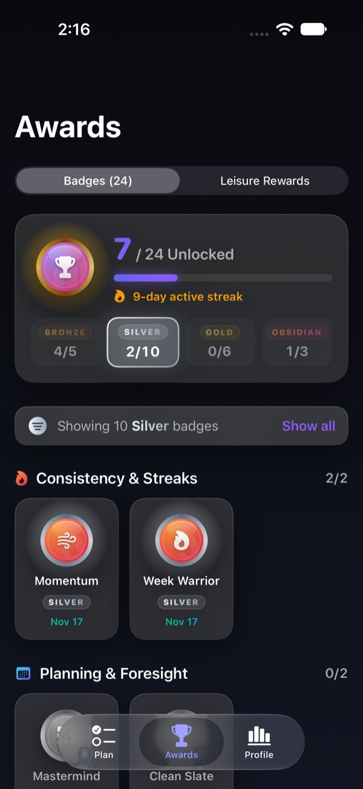
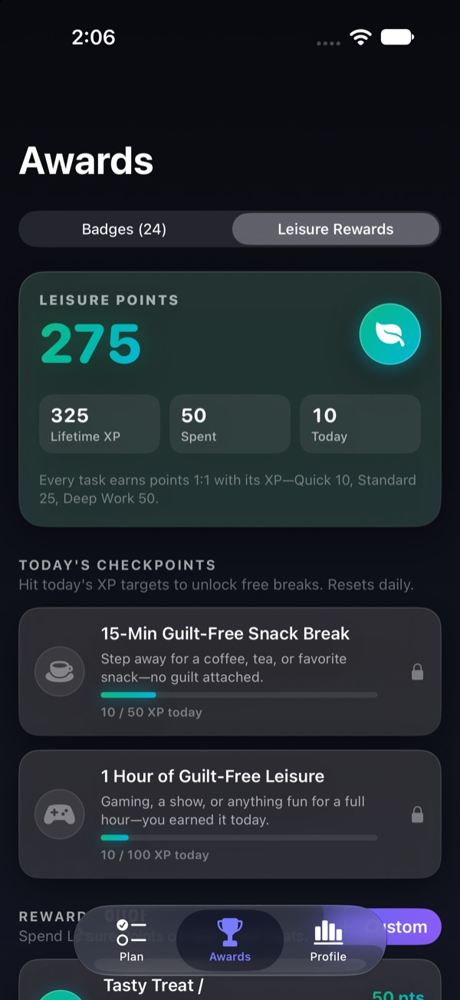
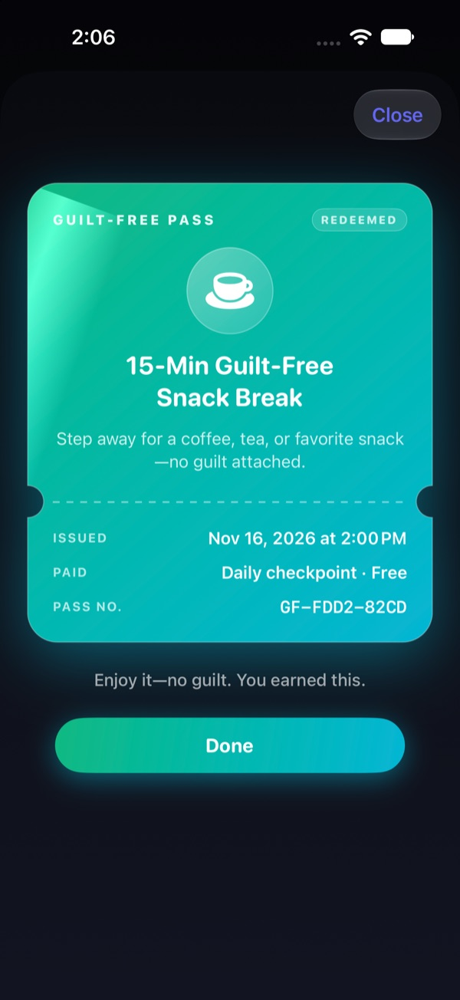
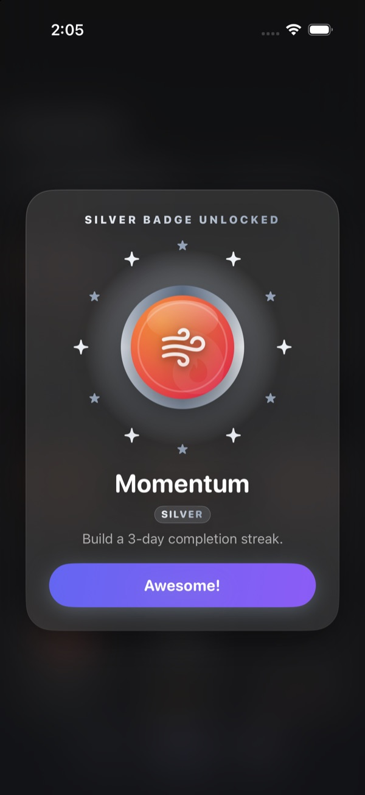
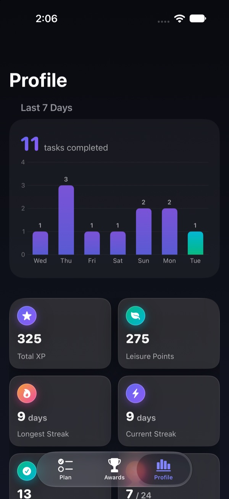
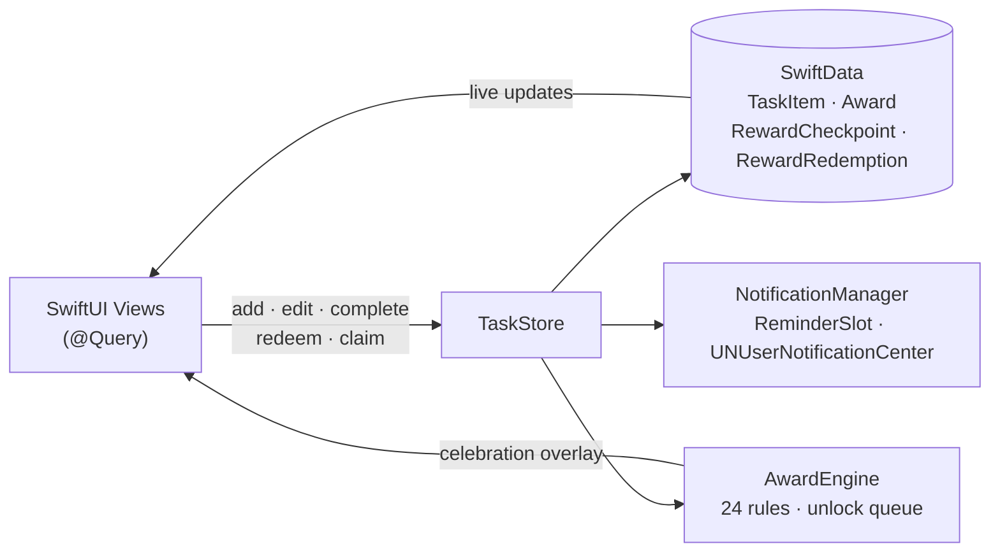

<p align="center">
  
</p>

<p align="center">
  
  
  
  
  
</p>

<p align="center">
  <b>A weekly &amp; upcoming task planner that turns follow-through into trophies — and trophies into real, guilt-free breaks.</b>
</p>

---

## ✦ Why Momentum

Most planners only tell you what's left. **Momentum** also tells you what you've *earned*.

Every completed task pays out twice:

| | Earned per task | Spent on |
|---|---|---|
| ⭐ **XP** | Quick **10** · Standard **25** · Deep Work **50** | Never spent — lifetime score that drives badges |
| 🍃 **Leisure Points** | 1 : 1 with XP | Real-world rewards: a snack, an hour of gaming, a lazy afternoon |

Hit daily XP checkpoints to unlock free breaks, save points for bigger treats, and collect 24 tiered badges along the way — all wrapped in a dark, glassy, gradient-lit interface.

---

## ✦ Screenshots

<table>
  <tr>
    <td align="center"><br><sub><b>Plan</b> · progress, points &amp; next checkpoint</sub></td>
    <td align="center"><br><sub><b>Trophy Case</b> · 24 badges, 4 tiers</sub></td>
    <td align="center"><br><sub><b>Tier filter</b> · tap a tier to focus</sub></td>
  </tr>
  <tr>
    <td align="center"><br><sub><b>Leisure Rewards</b> · balance &amp; checkpoints</sub></td>
    <td align="center"><br><sub><b>Guilt-Free Pass</b> · your earned voucher</sub></td>
    <td align="center"><br><sub><b>Unlock celebration</b> · spring + haptics</sub></td>
  </tr>
  <tr>
    <td align="center"><br><sub><b>Profile</b> · charts, stats &amp; reminders</sub></td>
    <td></td>
    <td></td>
  </tr>
</table>

---

## ✦ Features

### 🗓 Plan
- **Today / This Week / Upcoming** segmented views. This Week includes a 7-day calendar strip with per-day status dots; Upcoming shows everything more than 7 days out plus the unscheduled **Someday** backlog.
- **Glass header card** with a gradient progress bar and animated XP, Leisure Points and streak counters.
- **Next Checkpoint bar** right under the header — e.g. *"10 / 50 pts to unlock: 15-Min Guilt-Free Snack Break"*. When a checkpoint is reached it turns into a one-tap **Claim** button.
- Animated emerald checkboxes, effort pills, **swipe to delete**, and **swipe to reschedule** (Tomorrow · Next Week · Pick Date · Move to Someday).
- Overdue tasks surface automatically at the top of Today.

### 🏆 Trophy Case — 24 badges, 4 tiers
Each badge is a pure-SwiftUI **medallion**: a metallic tier rim around a glowing category-gradient core, layered SF Symbols and a specular highlight. Obsidian badges get a slowly rotating amber → rose rim. Locked badges render in grayscale with a progress bar; **secret badges show `???`** until discovered.

Tap a **tier chip** (Bronze · Silver · Gold · Obsidian) in the header to filter the case to that tier.

| Tier | Look | Count |
|---|---|---|
| 🥉 **Bronze** | Warm copper rim | 5 |
| 🥈 **Silver** | Brushed steel rim | 10 |
| 🥇 **Gold** | Polished gold rim + glow | 6 |
| 🔮 **Obsidian** | Black core, legendary amber → rose rim | 3 |

<details>
<summary><b>Full badge catalog</b> (secret milestones are behind a second spoiler)</summary>

<br>

**🔥 Consistency & Streaks**

| Badge | Tier | How to earn |
|---|---|---|
| Spark | 🥉 Bronze | Complete your first task |
| Hat Trick | 🥉 Bronze | Complete 3 tasks in one day |
| Momentum | 🥈 Silver | 3-day completion streak |
| Week Warrior | 🥈 Silver | 7-day completion streak |
| Fortnight Focus | 🥇 Gold | 14-day completion streak |
| Unbreakable | 🔮 Obsidian | 30-day completion streak |

**📅 Planning & Foresight**

| Badge | Tier | How to earn |
|---|---|---|
| Architect | 🥉 Bronze | Schedule 5 tasks for future dates in the upcoming week |
| Mastermind | 🥈 Silver | Schedule tasks on all 7 of the upcoming days |
| Clean Slate | 🥈 Silver | Reach 0 overdue tasks after completing at least 10 |
| Inbox Zero Hero | 🥇 Gold | Clear every task scheduled this week (Mon–Sun, at least 7) before Sunday night |

**📊 Volume & Effort**

| Badge | Tier | How to earn |
|---|---|---|
| Getting Rolling | 🥉 Bronze | Complete 10 tasks |
| Heavy Lifter | 🥈 Silver | Complete 10 Deep Work tasks |
| Quarter Century | 🥈 Silver | Complete 25 tasks |
| Centurion | 🥇 Gold | Complete 100 tasks |
| Titan of Focus | 🔮 Obsidian | Earn 2,500 lifetime XP |

**🕒 Time & Behavior**

| Badge | Tier | How to earn |
|---|---|---|
| Early Bird | 🥉 Bronze | Complete 5 tasks before 9:00 AM |
| Lunchtime Hustle | 🥈 Silver | Complete 5 tasks between 11:30 AM and 1:30 PM |
| Night Owl | 🥈 Silver | Complete 5 tasks after 8:00 PM |
| Weekend Warrior | 🥈 Silver | Complete 10 tasks on Saturdays or Sundays |
| Deep Work Marathon | 🥇 Gold | Complete 3 Deep Work tasks in a single day |

<details>
<summary><b>🕶 Secret Milestones — spoilers!</b></summary>

<br>

| Badge | Tier | How to earn |
|---|---|---|
| Comeback Kid | 🥈 Silver | Complete a task after missing 3+ days in a row |
| Speedrunner | 🥇 Gold | Complete 5 tasks within 2 hours of creating them |
| Overachiever | 🥇 Gold | Earn 250+ XP in a single day |
| Midnight Oil | 🔮 Obsidian | Complete a task between 12:00 AM and 3:00 AM |

</details>
</details>

Unlocking a badge triggers a full-screen celebration — springy medallion, radiating sparkles, tier-colored headline and a success haptic. Multiple unlocks queue up, rarest first. **Badges are never revoked**, even if you later un-check a task.

### 🍃 Leisure Rewards
**Daily checkpoints** — free, once per day, based on XP earned *today*:

| Checkpoint | Unlocks at |
|---|---|
| ☕ 15-Min Guilt-Free Snack Break | 50 XP today |
| 🎮 1 Hour of Guilt-Free Leisure | 100 XP today |

**Rewards shop** — spend Leisure Points:

| Reward | Cost |
|---|---|
| 🍰 Tasty Treat / Favorite Snack | 50 pts |
| 📺 30 Minutes of Guilt-Free Leisure | 75 pts |
| 🎨 1 Hour Gaming / Hobby Session | 150 pts |
| 🥡 Takeout / Favorite Meal Night | 300 pts |
| ☀️ Half-Day Off / Lazy Afternoon | 500 pts |

- **Custom rewards** — name, icon, cost (with quick presets) and notes. Long-press a custom reward to delete it.
- **Guilt-Free Pass** — every claim produces a ticket-style voucher with a notched perforation, a sweeping shine, an `ACTIVE` / `REDEEMED` stamp, timestamp and pass number (e.g. `GF-FDD2-82CD`). Past passes are listed and can be reopened.

### 🔔 Smart reminders
- Default schedule: **Morning Kickoff** 8:00 AM (always fires), **Midday Check-In** 12:00 PM and **Afternoon Final Push** 4:00 PM (only if tasks remain).
- Messages are written from your actual tasks — *"Good morning! You have 4 tasks planned today, starting with 'Draft Q4 roadmap'."* or *"2 tasks remaining today, including 'Review design mockups'. Finish strong to earn 75 XP!"*
- Fully editable: master switch, per-slot toggle, time, label and "only if tasks remain"; add or delete slots, or reset to default.
- Re-synced whenever a task changes, a reminder is edited, or the app returns to the foreground. Schedules today plus the next 7 days, capped at 60 pending requests (iOS allows 64).

### 📈 Profile
- 7-day completion bar chart (Swift Charts) with today highlighted in emerald.
- Stat cards: Total XP, Leisure Points, Longest Streak, Current Streak, Completed, Badges.
- Notification permission status with **Allow** / **Open Settings** shortcuts.
- **Reset & Re-Seed Demo Data** for testing.

---

## ✦ Design system

All styling lives in [`Theme.swift`](Momentum/Theme.swift). The app is dark-first and forces `.preferredColorScheme(.dark)` at the root, so every sheet, picker and tab stays consistent.

| Token | Value | Used for |
|---|---|---|
| Obsidian backdrop | `#090A0F` → `#121521` (vertical) | Every screen and sheet |
| Primary | `#6366F1` → `#8B5CF6` | Primary actions, XP progress |
| Success | `#10B981` → `#06B6D4` | Completed states, leisure unlocks |
| Legendary | `#F59E0B` → `#EC4899` | Rare / Obsidian badges, streaks |
| Glass card | Ultra-thin material + 1 px specular top edge (`white 12%`) + soft shadow | Cards, header, rewards |
| Numbers | SF Pro **Rounded** + `.contentTransition(.numericText())` | XP, streaks, points, progress |
| Text | SF Pro | Task titles and body copy |

Reusable components: `glassCard()`, `glassRow()`, `themedScreen()`, `GradientProgressBar`, `StatPill`, `GradientIcon`, `SectionTitle`, `BadgeMedallionView`, `TierLabel`, `TicketShape`.

---

## ✦ Architecture

Clean MVVM + services, with no third-party dependencies. Views read data with `@Query` and send every change through one `TaskStore`, which saves, re-evaluates badges and re-syncs reminders, so no view has to remember to.



### Data model

| Model | Kind | Purpose |
|---|---|---|
| `TaskItem` | `@Model` | Title, notes, optional date (`nil` = Someday), effort, completion timestamps |
| `Award` | `@Model` | Badge state: tier, category, secret flag, progress / target, unlock date |
| `RewardCheckpoint` | `@Model` | A daily checkpoint (XP threshold) or shop reward (point cost); built-in or custom |
| `RewardRedemption` | `@Model` | A claimed Guilt-Free Pass. Copies the reward's details so history survives edits or deletes |
| `ReminderSlot` | `Codable` struct | Reminder schedule, JSON-encoded in `UserDefaults` |

**Leisure Points balance** = lifetime XP − points spent, never shown below zero.

### Project structure

```
Momentum/
├── AppMain.swift             App entry, ModelContainer, TabView, unlock overlay
├── Theme.swift               Design tokens, glass modifiers, shared components
├── BadgeMedallionView.swift  Tiered medallion emblem + TierLabel
├── Models.swift              SwiftData models, enums, stats helpers, sample data
├── TaskStore.swift           Single mutation entry point (tasks + rewards)
├── AwardEngine.swift         24-badge catalog, rule evaluation, migration, unlock queue
├── RewardEngine.swift        Built-in rewards catalog + points / checkpoint math
├── NotificationManager.swift Smart reminder planning & scheduling
├── PlanView.swift            Plan tab, header card, Next Checkpoint bar, reschedule sheet
├── WeekStripView.swift       7-day calendar strip
├── TaskRowView.swift         Animated checkbox, effort badge, task row
├── AddTaskSheet.swift        Create / edit task (date chips, effort picker)
├── AwardsView.swift          Trophy case, tier filter, detail sheet, unlock banner
├── RewardsView.swift         Balance, checkpoints, shop, pass history, custom rewards
├── GuiltFreePassView.swift   Ticket-style voucher
└── StatsView.swift           Chart, stat cards, reminder settings
```

Every screen ships with `#Preview`s backed by `PreviewSampleData`, an in-memory store pre-filled with realistic tasks, rewards, passes and evaluated badges.

---

## ✦ Getting started

**Requirements:** Xcode 26 or later (Swift 6 toolchain) · iOS 17.0+ device or simulator · [XcodeGen](https://github.com/yonaskolb/XcodeGen) *(only if you add or rename files)*

```bash
git clone https://github.com/12KrishPatel/momentum-guilt-free-planner.git
cd momentum-guilt-free-planner
open Momentum.xcodeproj
```

Select the **Momentum** scheme and run on any iOS 17+ simulator.

The Xcode project is generated from [`project.yml`](project.yml). After adding, removing or renaming source files, regenerate it:

```bash
brew install xcodegen   # once
xcodegen generate
```

### Try it with demo data
Open **Profile → Testing → Reset & Re-Seed Demo Data** for a realistic setup: a 9-day streak, a handful of unlocked badges, today's plan, an overdue task, a well-planned week ahead, a backlog, and a couple of past passes. Your custom rewards are kept.

---

## ✦ Upgrading from V1

V2 opens V1 stores in place via SwiftData lightweight migration:

- V2-only award fields are stored as optionals, so rows created by V1 decode safely and are filled in from the catalog on first launch.
- Renamed badges carry their unlock over: **First Step → Spark**, **Sunday Planner → Architect**.
- Badges unlocked under V1's lower targets stay unlocked.
- Any badge your existing history already qualifies for unlocks, with its celebration, on first launch.

---

## ✦ Before shipping

- [ ] Replace the placeholder bundle identifier `com.example.momentum` in `project.yml`
- [ ] Add an app icon
- [ ] Verify notification delivery on a physical device

---

<p align="center">
  <sub>Built with SwiftUI, SwiftData, Swift Charts and UserNotifications. No third-party packages.</sub><br>
  <sub>✦ Plan the week · Earn the badges · Take the break — guilt-free ✦</sub>
</p>
